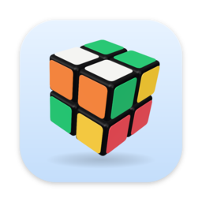
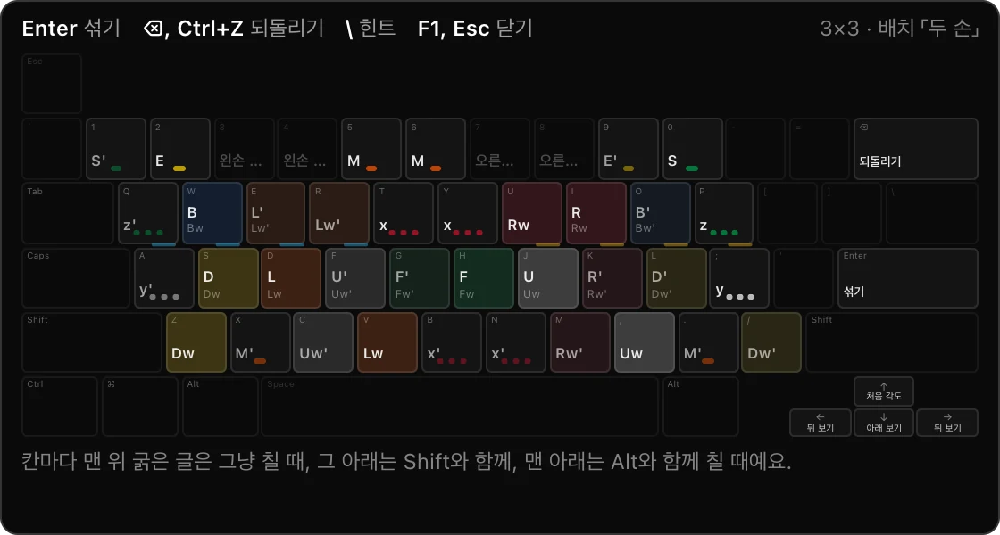
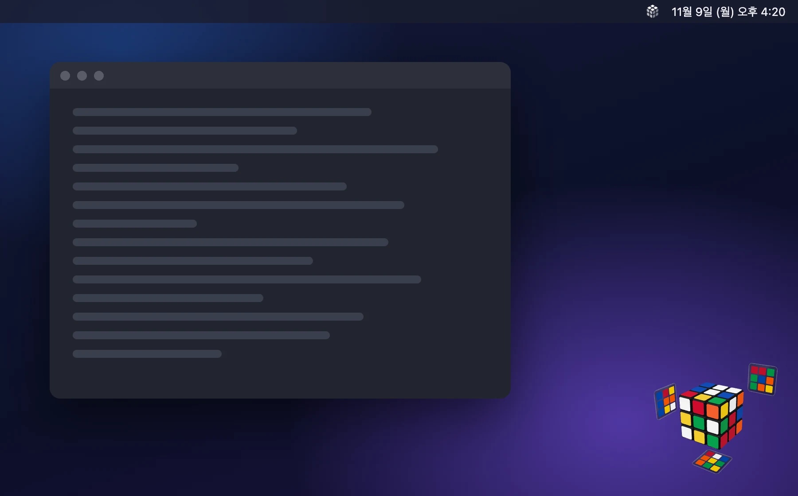
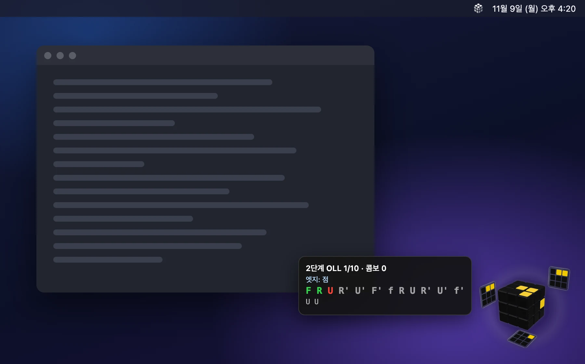
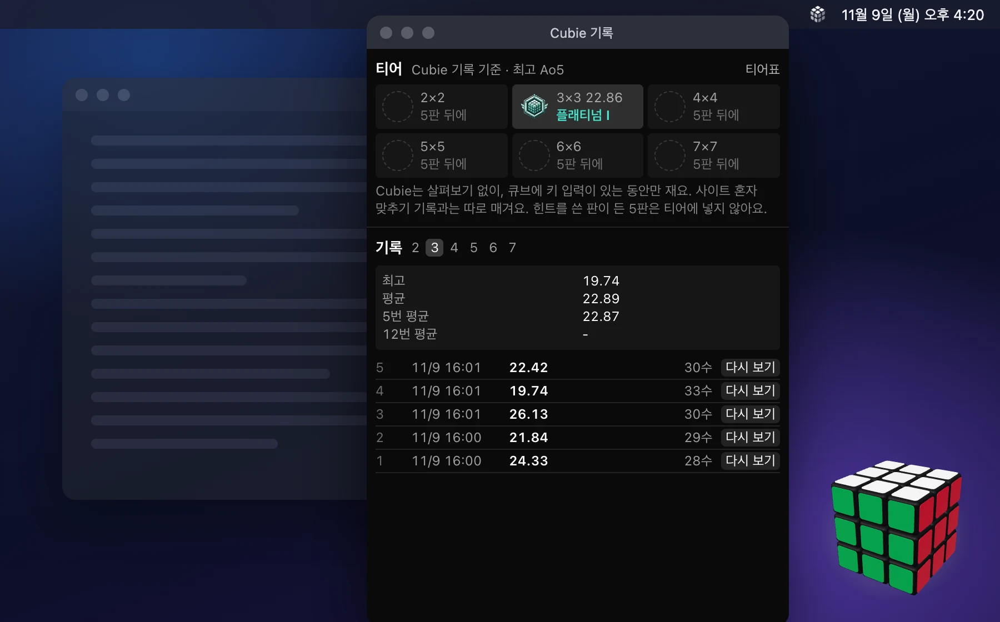
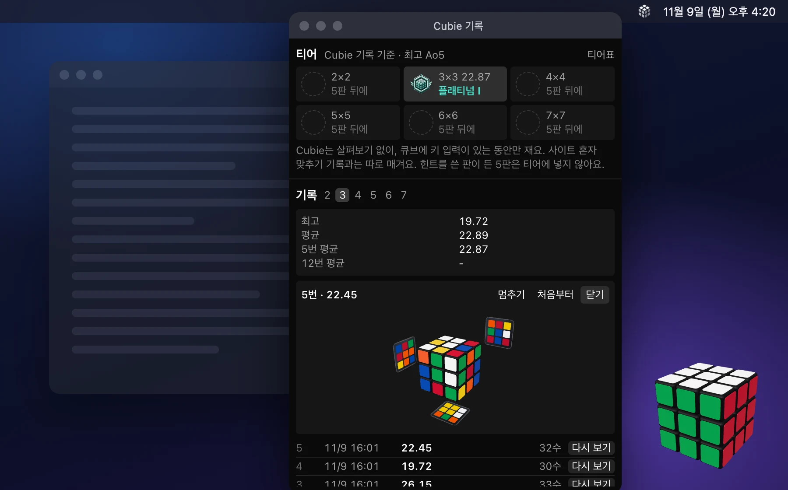
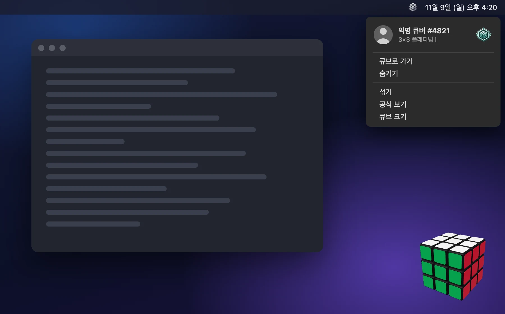

<p align="center">
  
</p>

<h1 align="center">Cubie</h1>

<p align="center">
  <b>화면 구석에 사는 작은 큐브.</b><br>
  일하다 머리 식히고 싶을 때, 단축키 한 번이면 바로 한 판.<br>
  <sub>A tiny Rubik's cube that lives in the corner of your Mac screen.</sub>
</p>

<p align="center">
  <a href="https://game.byb.kr/cubie/download"><b>⬇ macOS용 내려받기</b></a>
  · macOS 15 이상 · Apple Silicon과 Intel · 무료
</p>

<p align="center">
  
</p>

<p align="center">
  <b>Enter</b>로 섞고, <b>키보드</b>로 맞추세요.<br>
  키가 궁금하면 <b>F1</b>, 맞추는 법은 메뉴 「배우기」에서.
</p>

<p align="center">
  
</p>

책상 위에 큐브 하나 굴러다니면 괜히 손이 가잖아요. Cubie는 그 큐브를 맥 화면 구석에 놓아 둔 앱이에요. 바탕 없이 큐브만 다른 창 위에 동동 떠 있고, 어느 데스크톱으로 넘어가도 따라옵니다.

생각이 막힐 때 **⌃⌥⌘C**를 누르면 그대로 큐브를 돌릴 수 있어요. 마우스로 큐브를 찾아 누를 필요가 없어요. 그만하고 싶으면 **Esc**를 누르세요. 쓰던 앱으로 바로 돌아가고, 맞추던 큐브는 그 모양 그대로 기다립니다. 다음에 또 단축키를 누르면 이어서 맞추면 돼요.



<sub>화면 그림은 합성이에요. 큐브와 기록 창은 실제 Cubie 화면이고, 바탕화면·메뉴 막대·문서 창은 그려 넣었어요.</sub>

## 이런 게 돼요

**🎲 2×2부터 7×7까지 키보드로**
실제 큐브를 쥔 손가락 자리를 키보드에 옮긴 배치라, 몇 판 하다 보면 손이 먼저 기억해요. 큐브 타이머 사이트 csTimer와 같은 자리라서 그쪽을 써 봤다면 바로 손에 익어요.

**🪞 뒷면을 비추는 거울**
맞추는 동안 큐브 둘레에 작은 거울 셋이 떠서 안 보이는 왼쪽·뒤·아래 면을 보여 줘요. 큐브를 이리저리 돌려 보지 않아도 돼요.

**⏱ 기록과 티어**
섞고 첫 수를 둔 순간부터 시간을 재요. 다른 앱에 다녀온 시간은 빼고요. 5판 평균으로 아이언부터 챌린저까지 티어가 매겨집니다. 맞추는 동안에는 숫자를 띄우지 않으니 쫓기지 말고 돌리세요. 기록은 메뉴 「기록 보기」에 있어요. 메뉴 맨 위에는 익명 프로필과 지금 크기의 티어 엠블럼이 보여요. 기록은 크기마다 최근 100판까지 남아요.

**💡 막히면 공식 힌트**
2×2·3×3에서 OLL·PLL 공식이 기억 안 날 때 **\\** 키(Enter 바로 위)를 누르면 지금 모양에 맞는 공식 하나가 누를 키와 함께 5초 동안 떠요. 다만 너무 기대지 않게 20초에 한 번, 한 판에 3번까지만 볼 수 있어요. 힌트를 본 판은 티어 계산에서 빠져요. 공식을 처음부터 익히고 싶으면 메뉴 「배우기」로 사이트의 해법 익히기를 열면 돼요.

**⌨️ 공식 연습**
메뉴 「공식 연습」에서 단계를 고르면 공식이 하나 뜨고, 그대로 따라 치면 다 맞춰지면서 바로 다음 공식이 이어져요. 타자 연습처럼 한 판에 10문제예요. 공식에는 누를 키를 적지 않아서 공식을 치다 보면 키 배치가 손에 익어요. 틀린 수는 큐브에 들어가지 않고, 그 한 수의 키만 잠깐 보여 줘요. 틀리지 않고 이어 맞춘 공식 수만큼 콤보가 쌓이고, 판이 끝나면 정확도와 평균 시간, 1분에 친 수, 느렸던 공식을 보여 줘요. 단계는 짧은 것부터예요. 초보자 해법의 십자·2층·노란 십자·옆면 맞추기·코너 자리·코너 방향, 그다음 CFOP의 F2L·2단계 OLL·2단계 PLL·OLL·PLL. 공식은 큐브 옆 말풍선에 떠요. 외웠다 싶으면 「보고 치기」를 켜서 공식 없이 모양만 보고 쳐 보세요. 그만할 때는 **Esc**를 누르면 맞추던 큐브로 돌아가요. 연습 기록은 맞추기 기록·티어와 따로 남아요.

<p align="center">
  
</p>

**🎬 내가 맞춘 판 다시 보기**
기록 창에서 지난 판을 그때 속도 그대로 다시 볼 수 있어요. 맞춘 큐브를 가만히 두면 가끔 내 최고 기록 판과 가장 최근 판을 번갈아 혼자 다시 돌려 보여요. 긴 판도 그때 속도 그대로 돌리고, 오래 멈춘 곳만 1초로 줄여요. 그동안 큐브로 돌아오면 바로 멈춰요. 다시 보기는 크기마다 최근 30판과 최고 기록을 낸 5판에 남아요.

**🪶 가벼워요**
가만히 떠 있을 때는 CPU를 거의 쓰지 않아요. 만든 사람 맥에서 재 보니 0~1%였어요. 움직임은 다른 앱으로 넘어간 지 1분 뒤에야 시작하고, 「동작 줄이기」를 켜 두면 아예 움직이지 않아요.

**⚔️ 같이 하고 싶으면**
메뉴 「대결하기」를 누르면 [game.byb.kr 큐브](https://game.byb.kr/cube)가 열려요. 친구와 같은 섞기로 누가 먼저 맞추나 겨룰 수 있어요.

<table>
  <tr>
    <td></td>
    <td></td>
  </tr>
  <tr>
    <td align="center">기록과 티어</td>
    <td align="center">지난 판 다시 보기</td>
  </tr>
  <tr>
    <td></td>
    <td></td>
  </tr>
  <tr>
    <td align="center">메뉴 맨 위 프로필</td>
    <td></td>
  </tr>
</table>

## 설치

1. **[내려받기](https://game.byb.kr/cubie/download)** 를 눌러 받은 `Cubie.zip`을 풀어요.
2. `Cubie.app`을 「응용 프로그램」 폴더로 옮겨요.
3. 처음 열 때 macOS가 한 번 막아요. 애플의 유료 앱 검사(공증)를 받지 않은 개인 프로젝트라서 그래요. 코드는 이 저장소에 모두 공개되어 있어요. 아래 둘 중 편한 걸로 여세요.
   - Cubie를 한 번 열어 「열 수 없다」는 창이 뜨면 닫고, 「시스템 설정 → 개인정보 보호 및 보안」 맨 아래쪽 Cubie 줄에서 「그래도 열기」를 눌러요.
   - 터미널이 편하면 아래 한 줄을 실행해요. 인터넷에서 받은 파일에 붙는 격리 표시를 지우는 명령이에요.
     ```sh
     xattr -dr com.apple.quarantine /Applications/Cubie.app
     ```

   macOS 15부터는 예전처럼 오른쪽 클릭 → 열기로는 열리지 않아요.
4. 화면 오른쪽 아래에 큐브가 나타나고, 메뉴 막대에 큐브 아이콘이 생겨요. Dock에는 아이콘이 없어요.

업데이트는 Cubie가 알아서 챙겨요. 새 버전이 나오면 메뉴 맨 위에 「새 판 … 설치…」 한 줄이 생기니 눌러서 받으면 돼요.

## 쓰는 법

| 키·동작 | 하는 일 |
|---|---|
| ⌃⌥⌘C | 큐브로 가기. 큐브에 있을 때 다시 누르면 쓰던 앱으로 돌아가요 |
| Esc | 쓰던 앱으로 돌아가기. 큐브는 그대로 떠 있어요. 키보드 그림이 떠 있으면 그림 닫기, 공식 연습 중이면 연습 끝내기 |
| F1(맥북은 fn+F1) | 단축키 보기. 큐브 옆에 키보드 그림이 뜨고, 떠 있는 동안에도 키로 큐브를 돌릴 수 있어요. 한 번 더 누르면 닫혀요 |
| Enter | 섞기. 공식 연습 판이 끝났을 때는 한 판 더 |
| ⌫ | 한 수 되돌리기 |
| \\ | 공식 힌트. 공식 연습의 보고 치기에서는 공식 보기 |
| 큐브 클릭 | 큐브로 가기 |
| 큐브 끌기 | 창 옮기기. 다른 모니터로도 옮길 수 있어요. ⌘ + 끌기나 위 가운데 손잡이로도 돼요 |
| 큐브 위에서 핀치, 또는 ⌘ + 스크롤 | 창 크기 바꾸기. 오른쪽 아래 구석은 그 자리에 있어요 |
| 오른쪽 아래 손잡이 | 창 크기 바꾸기 |

마우스로는 큐브를 돌려 보지 않아요. 보는 각도는 큐브 통째 돌리기(x·y·z) 키로 바꿔요.

나머지는 메뉴 막대의 큐브 아이콘을 누르거나, 큐브 위에서 오른쪽 클릭하면 나와요. 단축키가 있는 항목은 메뉴 오른쪽에 키가 적혀 있어요.

<details>
<summary><b>키 배치 자세히</b></summary>

메뉴 「키 배치·색…」에서 두 배치 가운데 고르고, F1이나 메뉴 「단축키 보기」로 지금 배치를 큐브 옆 키보드 그림으로 볼 수 있어요.

그림과 아래 글에서 R·L·U·D·F·B는 오른쪽·왼쪽·위·아래·앞·뒤 면을 시계 방향으로 한 번 돌리는 것이고, 뒤에 붙은 '는 반대 방향이에요.

- **두 손**(기본): 실제 큐브를 돌리는 손가락 자리를 옮긴 배치예요. 키마다 돌리는 면은 맨 위 키보드 그림에 있어요. Shift를 함께 누르면 그 면과 바로 안쪽 층을 함께 돌려요. 숫자 n을 먼저 치면 다음 면 키는 그 면에서 n번째 층 하나만, Shift + 면 키는 바깥 n층을 함께 돌려요. 숫자는 다음 수 하나에만 붙어요. 그래서 3×3의 가운데 세로 층은 2 다음 I(T·B 키로도 쳐요), 7×7의 바깥 세 층은 3 다음 Shift+I예요.

- **표기**: 면 글자와 같은 키예요. R 키가 R, Shift+R이 R'이고, Alt를 함께 누르면 안쪽 층까지 돌려요.

</details>

<details>
<summary><b>메뉴에 있는 것</b></summary>

위에서부터 이렇게 묶여 있어요.

- **맞추기**: 섞기, 힌트, 공식 연습(초보자·CFOP 단계, 보고 치기, 연습 끝내기), 큐브 크기(2×2~7×7)
- **기록**: 기록 보기, 티어표
- **사이트에서 열기**: 대결하기(친구와·컴퓨터와), 배우기(해법 익히기)
- **창과 키**: 창(크기 작게·보통·크게·아주 크게, 화면 옮기기, 거울 켜고 끄기, 자리 처음으로), 키 배치·색…, 단축키 보기
- **그 밖**: 다시 불러오기, 업데이트 확인, 끝내기

- 화면 옮기기는 모니터가 둘 이상일 때만 「창」 안에 보여요. 고른 모니터의 오른쪽 아래로 큐브를 옮겨요.
- 업데이트 확인과 끝내기는 메뉴 막대 쪽 메뉴에만 있어요.
- 로그인할 때 저절로 켜지게 하려면 「시스템 설정 → 일반 → 로그인 항목」에 Cubie를 추가하세요.

</details>

<details>
<summary><b>개인정보와 인터넷</b></summary>

큐브 창은 앱이 직접 그려요. 섞기·판정·티어 계산은 게임 사이트 [game.byb.kr](https://game.byb.kr)과 같은 규칙으로 앱 안에서 해요. 기록 보기·티어표·키 배치와 색 설정처럼 큰 화면만 사이트 화면을 앱 안 창으로 열어요.

- **인터넷**: 큐브를 맞추고 기록을 남기는 데는 인터넷이 없어도 돼요. 기록 보기·티어표·키 배치와 색 설정 창을 열 때만 사이트 화면을 받아요.
- **기록은 내 맥에만**: 맞춘 시간, 다시 보기, 공식 연습 기록, 키 배치와 색은 앱 안에만 저장해요. 서버로 보내지 않고, 계정이나 가입도 없어요. 예전 판(0.1.10까지)에서 쌓은 기록은 처음 띄울 때 한 번 옮겨 와요. 예전 자리의 기록은 지우지 않아요.
- **사이트 방문 집계**: game.byb.kr은 페이지가 몇 번 열렸는지를 쿠키 없이 세요. 기록 보기 같은 사이트 창을 열 때 한 건으로 세어지지만, 기록이나 키 입력은 들어가지 않아요. 자세한 건 사이트의 [보안 설명](https://game.byb.kr/security)에 있어요.
- **업데이트**: 사이트의 버전 목록 `game.byb.kr/cubie/appcast.xml`을 하루 한 번 확인하고, 새 버전 파일은 GitHub에서 받아요. 만든 사람이 서명한 파일일 때만 설치해요. 버전마다 바뀐 내용은 [release-notes](release-notes/) 폴더에 있어요.

</details>

<details>
<summary><b>잘 안 될 때</b></summary>

**메뉴 막대에 큐브 아이콘이 안 보여요.** Ice, Bartender 같은 아이콘 숨기기 앱이 숨겼거나, 노치 있는 맥북에서 아이콘이 많아 가려졌을 수 있어요. 숨기기 앱에서 Cubie를 늘 보이게 두거나, 큐브 위에서 오른쪽 클릭해 메뉴를 여세요. 아이콘 없이 끄려면 「활성 상태 보기」에서 Cubie를 종료하거나 터미널에서 `pkill -x Cubie`를 실행하세요.

**⌃⌥⌘C를 눌러도 큐브로 안 가요.** 다른 앱이 같은 단축키를 쓰고 있으면 메뉴 막대 아이콘에 느낌표가 붙고 메뉴 맨 위에 알려 줘요. 지금은 Cubie 쪽 단축키를 바꿀 수 없으니, 그 앱의 단축키를 바꾸거나 메뉴 「큐브로 가기」를 쓰세요.

**큐브가 사라졌어요.** 메뉴 「보이기」를 누르세요. 모니터를 떼면 큐브는 남은 화면으로 저절로 옮겨 오고, 다시 붙이면 그 모니터에서 두던 자리로 돌아가요. 그래도 안 보이면 메뉴 「창」에서 「자리 처음으로」를 누르세요. 메뉴 막대가 있는 화면의 오른쪽 아래로 돌아와요.

**기록 보기·티어표 창이 비어 있어요.** 이 창들은 사이트 화면이에요. 인터넷 연결을 확인하고 창을 닫았다 다시 여세요.

</details>

<details>
<summary><b>지우기</b></summary>

Cubie를 끝내고 「응용 프로그램」에서 `Cubie.app`을 휴지통으로 옮기면 돼요. 기록과 설정까지 지우려면 아래 폴더와 파일도 지우세요.

```
~/Library/Preferences/kr.byb.cubie.plist        # 기록·설정(앱 저장소)
~/Library/WebKit/kr.byb.cubie
~/Library/Caches/kr.byb.cubie
~/Library/HTTPStorages/kr.byb.cubie
```

</details>

## 요구 사항

- macOS 15 Sequoia 이상
- Apple Silicon 맥, Intel 맥 모두
- 기록 보기·티어표·설정 창을 열 때 인터넷 연결

## 라이선스

[MIT](../../LICENSE). Cubie는 [game.byb.kr](https://game.byb.kr) 게임 모음 저장소의 일부예요. 직접 빌드하거나 고쳐 보고 싶으면 [DEVELOPMENT.md](DEVELOPMENT.md)를 보세요.
